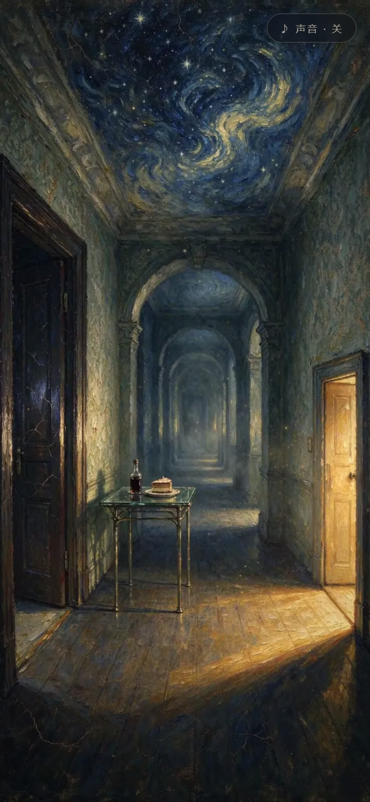
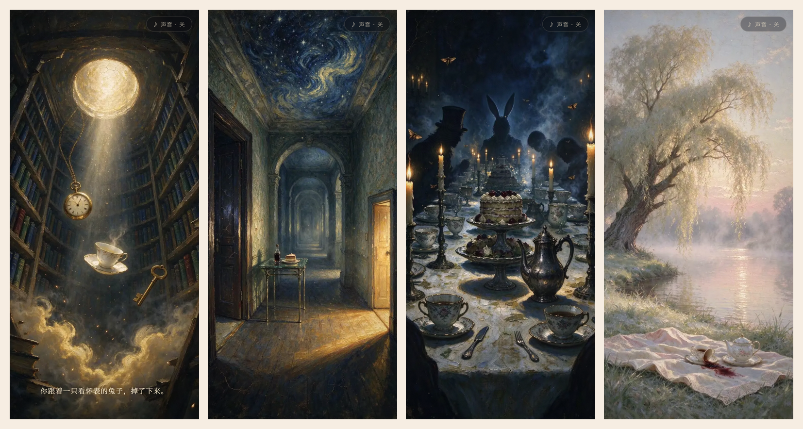

# 掉进兔子洞

八幕，约四分钟。一场用油画做的梦。

双击 **`alice.html`** 就能走进去。不需要联网，不需要安装任何东西。



## 八幕

| # | 场景 | 你做的事 |
|---|---|---|
| 1 | 坠落 | 点下面的云 |
| 2 | 门厅 | 喝「喝我」——喝了就会变小 |
| 3 | 变小之后 | 点门缝里的光 |
| 4 | 岔路 | 随便选一扇门 |
| 5 | 茶会 | 点那块蛋糕，蜡烛会灭 |
| 6 | 红心花园 | 点小径尽头的长矛手 |
| 7 | 审判 | 点王座 |
| 8 | 醒来 | 什么都不用做 |



## 怎么玩

一个手势：点。有光、有人影、有东西在动的地方都可以点。

- 手机竖着拿最好看；桌面会把整幅画居中，两边用同一张画虚化补满。
- 右上角可以打开声音（默认关）。声音是现场合成的，没有音频文件。
- 每个场景停一会儿，会有一个很轻的呼吸圈提示你该点哪儿。
- 点错了、站着不动，都不会卡住。

## 它是怎么“活”的

不是把图片一张张翻过去。每张画都在动：

- **颜料在流**：整幅画的笔触有极缓慢的位移，像还没干；
- **天花板在转**：画面上方的涡流比别处动得明显一点；
- **光在抖**：门缝、烛火是不规则地闪，不是正弦波；
- **镜头有手持感**：缓慢漂移加一点微颤，鼠标划过还有一点视差。

**转场**是湿颜料被抹开：从你手指点的位置开始，一层噪声把画面吃掉，接缝处两幅画沿着笔触方向错开几个像素，所以看着像被抹开，而不是叠化。

## 技术

- 单个 `alice.html`，约 2.1 MB，八张油画全部内嵌（WebP，900×1600）。
- 画面由 WebGL 着色器实时处理：流动、涡流、光、颗粒、暗角都在 GPU 上。
- 转场用两张纹理 + 噪声遮罩，耗时 3.2 秒。
- 声音用 Web Audio 现场合成（低频嗡鸣 + 很稀的八音盒），没有素材文件。
- 桌面横屏时自动切换成“整幅居中”，不会裁成特写。

## 已知的问题

- 转场 3.2 秒，偏慢；想快可以改 `dur`。
- 没有存档，一次走完；中途关掉得从头开始。
- 岔路的三扇门最后都通向茶会——梦替你选，不是真分支。
- 桌面端两侧的虚化背景在极宽屏上会显得空。

## 文件

```
alice.html              完整作品，双击即开
alice-walkthrough.mp4   前四幕的录屏（约 30 秒）
preview.png             门厅
preview-scenes.png      四幕拼图
images/full/            八张原图
images/web/             压缩后的 WebP
lab/                    早期两个转场试验，留着做对照
```
